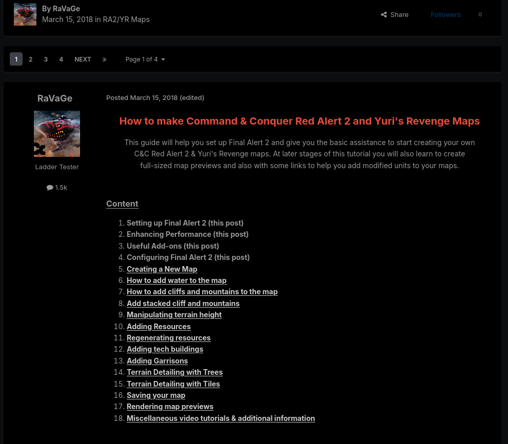
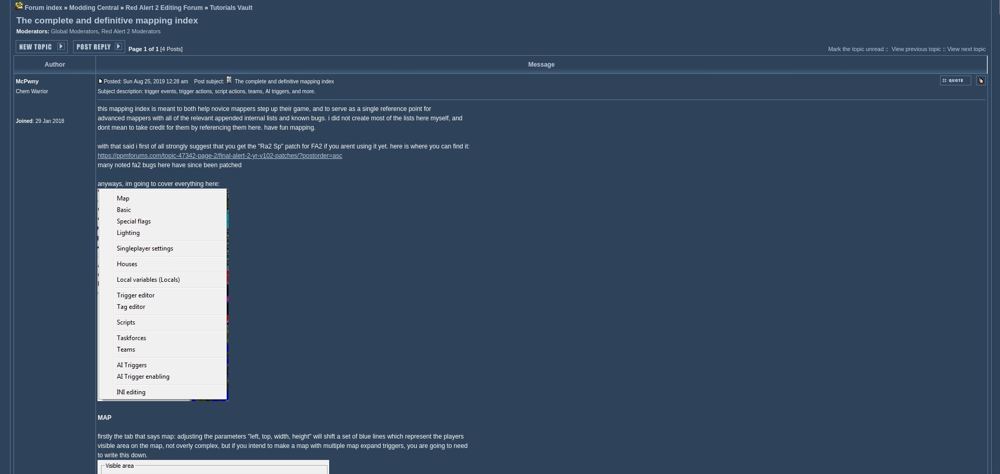
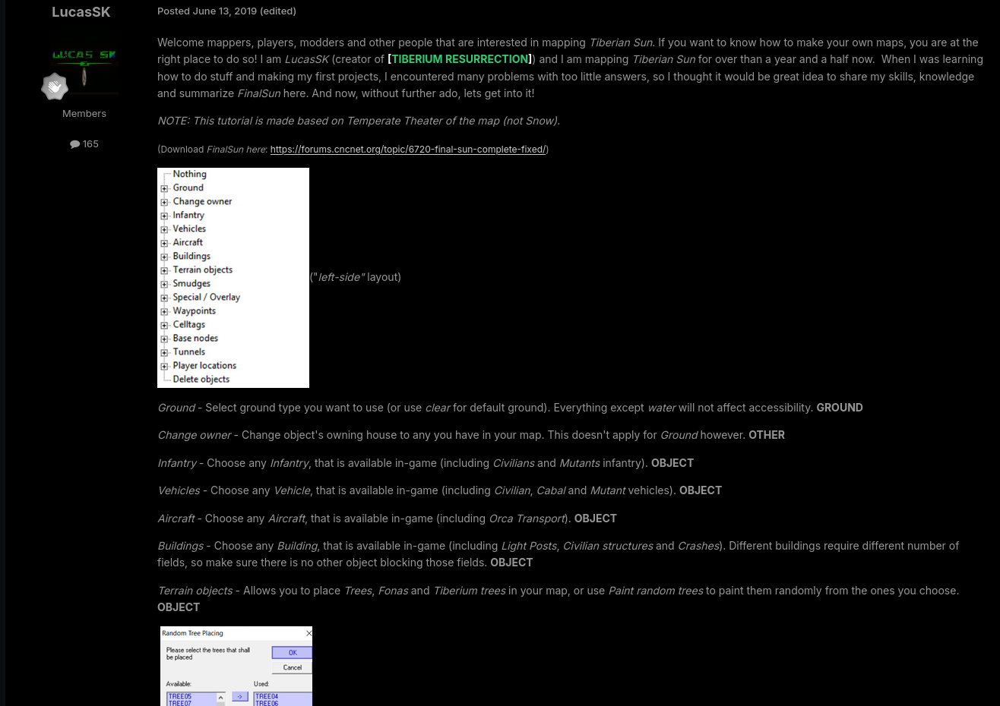
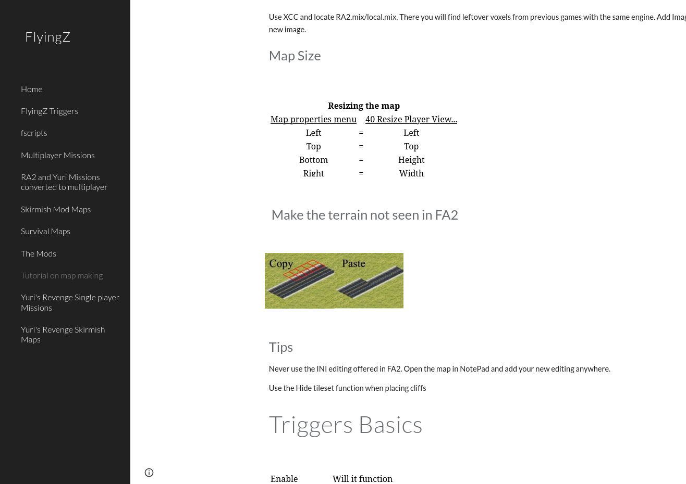
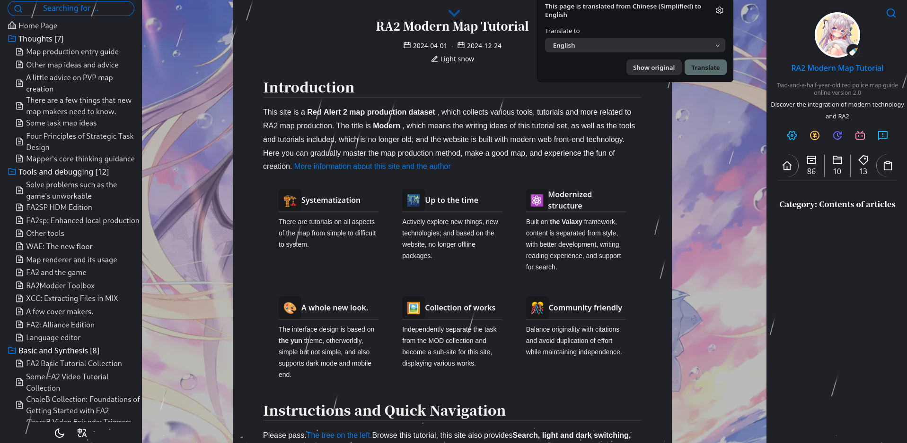
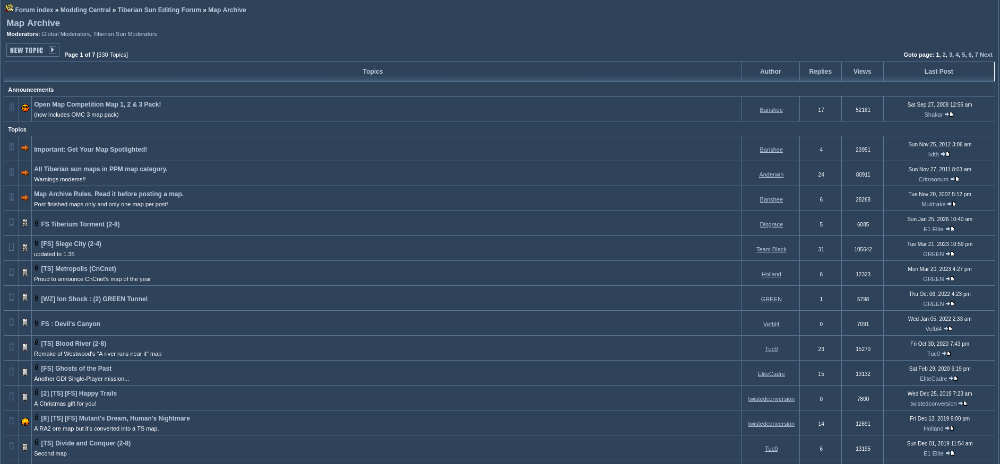
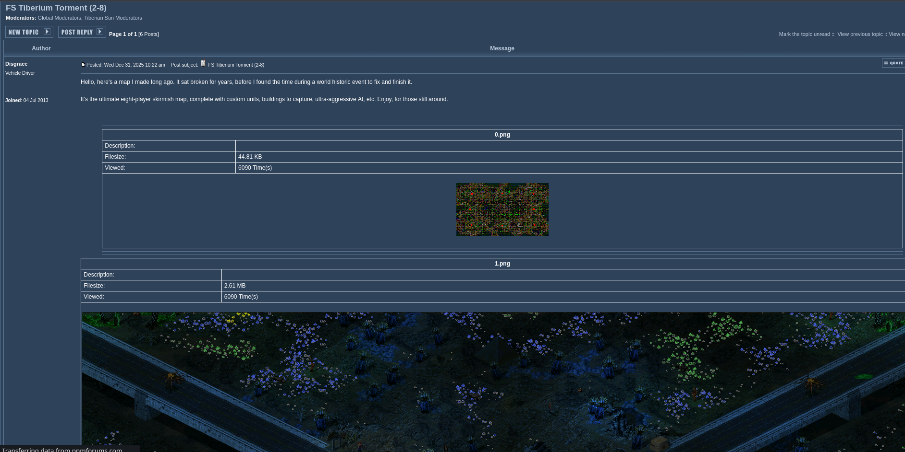
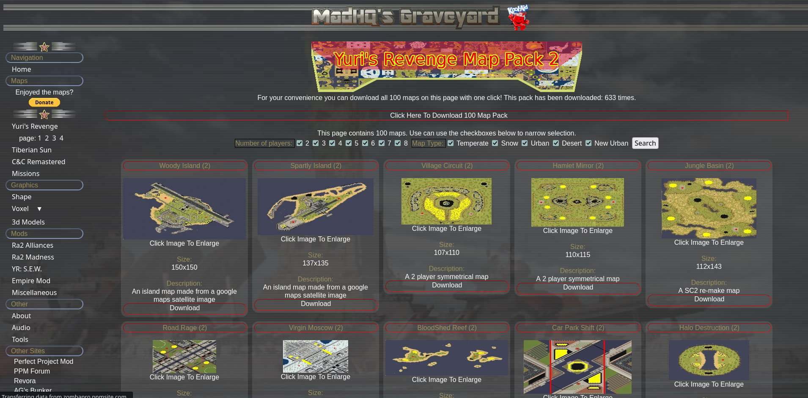
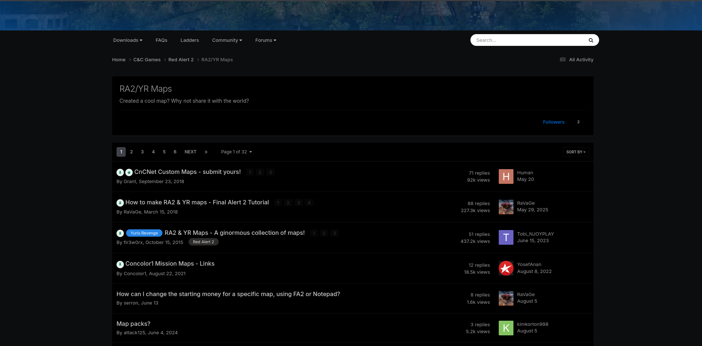
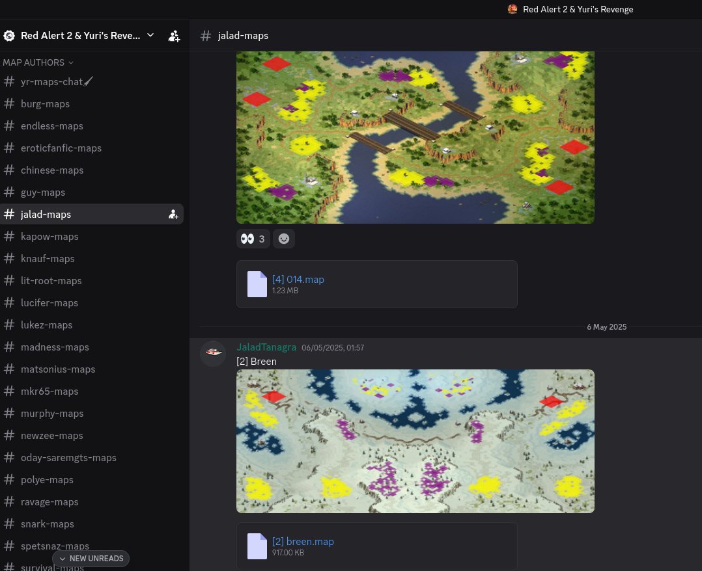

# Map Resources

### Video Resources

<iframe width="560" height="315" src="https://www.youtube.com/embed/videoseries?si=mszsC42hiuAeNnvm&amp;list=PLPTX4WpN_n2Pd1duBlBT8Ht5OFiuKy_JS" title="YouTube video player" frameborder="0" allow="accelerometer; autoplay; clipboard-write; encrypted-media; gyroscope; picture-in-picture; web-share" referrerpolicy="strict-origin-when-cross-origin" allowfullscreen></iframe>

<iframe width="560" height="315" src="https://www.youtube.com/embed/videoseries?si=yCzt-LSBkOYyYs5t&amp;list=PLa9Udz4hdmEOVfsjXD36XUgvSigAPMpST" title="YouTube video player" frameborder="0" allow="accelerometer; autoplay; clipboard-write; encrypted-media; gyroscope; picture-in-picture; web-share" referrerpolicy="strict-origin-when-cross-origin" allowfullscreen></iframe>

<iframe width="560" height="315" src="https://www.youtube.com/embed/videoseries?si=26x0qZy1v_NLckiz&amp;list=PLSe1fqlsB-g45L-iHP01YevQVbD2DaDOt" title="YouTube video player" frameborder="0" allow="accelerometer; autoplay; clipboard-write; encrypted-media; gyroscope; picture-in-picture; web-share" referrerpolicy="strict-origin-when-cross-origin" allowfullscreen></iframe>

<iframe width="560" height="315" src="https://www.youtube.com/embed/KywxRxdLzus?si=fFFltWnvqOTInEXo" title="YouTube video player" frameborder="0" allow="accelerometer; autoplay; clipboard-write; encrypted-media; gyroscope; picture-in-picture; web-share" referrerpolicy="strict-origin-when-cross-origin" allowfullscreen></iframe>

<iframe width="560" height="315" src="https://www.youtube.com/embed/HAH43FvXvxc?si=ehR9EGPglRanTHA4" title="YouTube video player" frameborder="0" allow="accelerometer; autoplay; clipboard-write; encrypted-media; gyroscope; picture-in-picture; web-share" referrerpolicy="strict-origin-when-cross-origin" allowfullscreen></iframe>

#### Written Tutorials

Making Maps in FA2YR  - [CnCNet Forums](https://forums.cncnet.org/topic/8245-how-to-make-ra2-yr-maps-final-alert-2-tutorial/) 

Scripting Index - [PPM Forums](https://ppmforums.com/topic47332/thecompleteanddefinitivemappingindex/)

Making maps in FS - [CnCNet](https://forums.cncnet.org/topic/9934-finalsun-complete-tutorial/)

Various resources - [Google Sites](https://sites.google.com/site/flyingzmaps/Home) 

RA2 Modern Map Tutorials, a chinese websaite that holds a similar purpose to this one, and has a much larger amount of resources, maps and tutorials - [RA2Map.com](https://ra2map.com/)

### Community Mapping Archives:

Mainly intended for users who want to try custom maps, and mod developers to find new community maps

Public Map Archives on PPM Forums. Please scroll down to the Tiberian Sun & Red Alert 2 sections and check the map archive there - [PPM Forums](https://ppmforums.com/) 

MadHQ's Maps + Resources, containing hundreds of multiplayer maps, campaigns, and a few modding resources too - [MadHQ's Graveyard](http://zombapro.ppmsite.com/index.php?page=Yuri%27s+Revenge)

Public Map Archives hosted by CnCnet - [CncNet Forums](https://forums.cncnet.org/forum/63ra2yrmaps/).

Map Downloads for Yuri's Revenge - [Discord - Yuri's Revenge](https://discord.gg/NX2PnauTVh)|

### Noteworthy Projects:

A collection of major projects that community members have made, culled down to smalled teams as otherwise i'd be listing quite a lot of mods (Mental Omega, Red Alert 20XX, Fading Dusk, etc).

<iframe width="560" height="315" src="https://www.youtube.com/embed/videoseries?si=6xwCdAcsBqYmen9M&amp;list=PLUPhBMXB4tMewNUTpgREV1ONA-2GS1x91" title="YouTube video player" frameborder="0" allow="accelerometer; autoplay; clipboard-write; encrypted-media; gyroscope; picture-in-picture; web-share" referrerpolicy="strict-origin-when-cross-origin" allowfullscreen></iframe>

MadHQ has remade the RA2 Allied and Soviet Campaigns entirely, designed for the vanilla game. These are significantly larger than their predecesors, and do offer a long playthrough while being for the unmodded base game. These are hosted in [MadHQ's Graveyard](http://zombapro.ppmsite.com/index.php?page=Missions).

<iframe width="560" height="315" src="https://www.youtube.com/embed/lQRKGVb6aHg?si=ZfStmI8lu5-_1lYE" title="YouTube video player" frameborder="0" allow="accelerometer; autoplay; clipboard-write; encrypted-media; gyroscope; picture-in-picture; web-share" referrerpolicy="strict-origin-when-cross-origin" allowfullscreen></iframe>

Almost Perfect Red Alert 2 (APRA2) is a fan project to produce a Red Alert 2 campaign in Mental Omega. The team has made a complete lineup of high quality work that is publicly available, and consists of quite a few skilled and experienced mappers who anyone could learn from. An excellent benchmark for any modern campaign developers who intend to use a mod's features (including assets and engine extensions) to create something adventurous. You can find out more on their [discord](https://discord.gg/Z7HsWA5pTv), as well as download maps and full scale renders off their [GitHub](https://github.com/Resarium/APRA2-Public/tree/main)

<iframe width="560" height="315" src="https://www.youtube.com/embed/jEOg1vQhLBQ?si=Fg6MEoTHAKqQM6Qx" title="YouTube video player" frameborder="0" allow="accelerometer; autoplay; clipboard-write; encrypted-media; gyroscope; picture-in-picture; web-share" referrerpolicy="strict-origin-when-cross-origin" allowfullscreen></iframe>

Dawn of the Tiberium Age has been working on recreating the [original TD Campaigns](https://www.moddb.com/mods/thedawnofthetiberiumage/news/annoucingourtdgdicampaigncoopremake) as Co-Op maps, which is representative of what can be achieved on the Tiberian Sun engine (with extensions) and with scripting limitations that online play introduces. You can also find out more on their [discord](https://discord.gg/YczsdZC).  

<iframe width="560" height="315" src="https://www.youtube.com/embed/di4QLHd2bVo?si=k67XOiECFEaDtsur" title="YouTube video player" frameborder="0" allow="accelerometer; autoplay; clipboard-write; encrypted-media; gyroscope; picture-in-picture; web-share" referrerpolicy="strict-origin-when-cross-origin" allowfullscreen></iframe>

Flipped Missions is a mod for YR which reverses the roles of original YR missions so you play as the other side, of course with some methods to make this playable and not an instant win against an Ai conyard. You can find out more on their [ModDB](https://www.moddb.com/mods/ra2fm) and [discord](https://discord.gg/tYuP82S)
